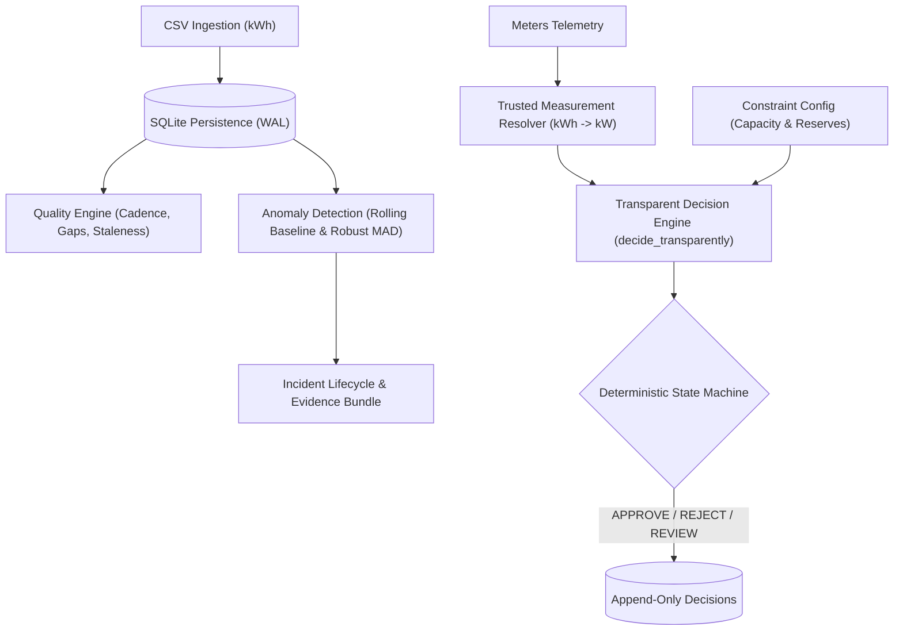

# EcoFac: Comprehensive Engineering Defect Specification & Remediation Blueprint

**Document Reference:** `ECOFAC-SPEC-2026-001`  
**Classification:** Engineering Defect Catalog & Technical Remediation Plan  
**Target Codebase:** `EcoFac-main` (Python 3.11+, FastAPI, SQLite)  
**Status:** Ready for Engineering Execution  

---

## Table of Contents

1. [Architecture & System Context](#1-architecture--system-context)
2. [Section A: Persistence, Migrations & Concurrency](#section-a-persistence-migrations--concurrency)
   - [DEF-01: Dead Code in Schema Migration Path Discovery](#def-01-dead-code-in-schema-migration-path-discovery)
   - [DEF-02: SQLite Schema Migration DDL Crash on Pre-existing Columns](#def-02-sqlite-schema-migration-ddl-crash-on-pre-existing-columns)
   - [DEF-03: Transaction Protocol Crash & Exception Masking in Incident Lifecycle](#def-03-transaction-protocol-crash--exception-masking-in-incident-lifecycle)
   - [DEF-04: Incomplete Supersession Tree Traversal & Downward Infinite Loop Hazard](#def-04-incomplete-supersession-tree-traversal--downward-infinite-loop-hazard)
   - [DEF-05: Static Import-Time Evaluation of `DB_PATH`](#def-05-static-import-time-evaluation-of-db_path)
3. [Section B: API Security, Authentication & Access Control](#section-b-api-security-authentication--access-control)
   - [DEF-06: Unauthenticated Write and Lifecycle Mutation Endpoints](#def-06-unauthenticated-write-and-lifecycle-mutation-endpoints)
   - [DEF-07: Rate Limiter Token Spoofing Bypass](#def-07-rate-limiter-token-spoofing-bypass)
   - [DEF-08: Trivial IP Spoofing via `X-Forwarded-For`](#def-08-trivial-ip-spoofing-via-x-forwarded-for)
   - [DEF-09: Unbounded In-Memory Bucket Leak (Denial of Service)](#def-09-unbounded-in-memory-bucket-leak-denial-of-service)
   - [DEF-10: Timing Side-Channel on Write Token Comparison](#def-10-timing-side-channel-on-write-token-comparison)
   - [DEF-11: ASGI Protocol Exception Handling Failure in Body Size Limiter](#def-11-asgi-protocol-exception-handling-failure-in-body-size-limiter)
4. [Section C: Decision Engine, Numerical & Domain Logic](#section-c-decision-engine-numerical--domain-logic)
   - [DEF-12: The Fencepost Quality Assessment Bug Blocking Operational Approvals](#def-12-the-fencepost-quality-assessment-bug-blocking-operational-approvals)
   - [DEF-13: Baseline Poisoning and Anomaly Suppression in Comparable-Period Check](#def-13-baseline-poisoning-and-anomaly-suppression-in-comparable-period-check)
   - [DEF-14: Silent Dropping of Sub-Unity PUE Steps in Sensitivity Sweep](#def-14-silent-dropping-of-sub-unity-pue-steps-in-sensitivity-sweep)
   - [DEF-15: Thermodynamic Decoupling of Electrical and Cooling Balances](#def-15-thermodynamic-decoupling-of-electrical-and-cooling-balances)
   - [DEF-16: Limiting Factor Selection Distortion Across Heterogeneous Capacities](#def-16-limiting-factor-selection-distortion-across-heterogeneous-capacities)
   - [DEF-17: Dead Code in Uncertainty Engine & Masking of Unbounded Tolerances](#def-17-dead-code-in-uncertainty-engine--masking-of-unbounded-tolerances)
   - [DEF-18: Type Coercion False Positive Differences in Scenario Comparison](#def-18-type-coercion-false-positive-differences-in-scenario-comparison)
   - [DEF-19: Unapplied / Conflicting Repository Patch (`c.patch`)](#def-19-unapplied--conflicting-repository-patch-cpatch)
5. [Section D: Benchmarking, Evaluation & Simulator Integrity](#section-d-benchmarking-evaluation--simulator-integrity)
   - [DEF-20: Evaluation Metric Inflation / Data Quality Leakage](#def-20-evaluation-metric-inflation--data-quality-leakage)
   - [DEF-21: Arbitrary Endpoints & Linear Distortion in PR-AUC Integration](#def-21-arbitrary-endpoints--linear-distortion-in-pr-auc-integration)
   - [DEF-22: Hardcoded Hourly Cadence Assumption in Intervention Verification](#def-22-hardcoded-hourly-cadence-assumption-in-intervention-verification)
6. [Section E: Frontend, Demo Seeding & Tooling](#section-e-frontend-demo-seeding--tooling)
   - [DEF-23: JavaScript Error Object Coercion to `[object Object]`](#def-23-javascript-error-object-coercion-to-object-object)
   - [DEF-24: Demo Data Missing Roles and Tolerances Breaking Trusted Mode](#def-24-demo-data-missing-roles-and-tolerances-breaking-trusted-mode)
   - [DEF-25: Script Execution Failures due to Missing `src/` in Python Path](#def-25-script-execution-failures-due-to-missing-src-in-python-path)
   - [DEF-26: Preflight Validation Missing from CI Pipeline](#def-26-preflight-validation-missing-from-ci-pipeline)
7. [Implementation Matrix & Critical Path](#7-implementation-matrix--critical-path)

---

## 1. Architecture & System Context

EcoFac is an energy intelligence backend designed for facilities and data centers. It ingests time-series meter telemetry (energy consumption in kWh), assesses data quality across sliding observation windows, executes statistical anomaly detection, attaches deterministic evidence bundles, and provides a decision engine for evaluating operational changes against physical and reserve capacity constraints.



While individual algorithmic modules exhibit clean mathematical isolation, systemic discrepancies between component contracts introduce vulnerabilities, data corruption, and operational deadlocks.

---

## Section A: Persistence, Migrations & Concurrency

### DEF-01: Dead Code in Schema Migration Path Discovery
* **File:** [`src/ecofac/persistence/database.py`](file:///c:/Users/Public/NGL/EcoFac-main/src/ecofac/persistence/database.py#L96-L100)
* **Function:** [`_apply_migrations`](file:///c:/Users/Public/NGL/EcoFac-main/src/ecofac/persistence/database.py#L86-L113)
* **Severity:** **CRITICAL**

#### Problem Statement
The database initialization routine attempts to discover numbered SQL migration files via:
```python
migrations_dir = pathlib.Path(__file__).parent.parent.parent / "migrations"
```
Because `__file__` is located at `<workspace>/src/ecofac/persistence/database.py`, three `parent` calls resolve as follows:
1. `parent` = `<workspace>/src/ecofac/persistence`
2. `parent.parent` = `<workspace>/src/ecofac`
3. `parent.parent.parent` = `<workspace>/src`

The code checks if `<workspace>/src/migrations` exists. The actual migrations directory is situated at `<workspace>/migrations`. Consequently, `migrations_dir.exists()` evaluates to `False`, and the function returns immediately without executing any migrations.

#### Operational Impact
In-place database migrations are completely non-functional. Existing deployments cannot be upgraded using automated migration scripts. The application silently runs on an unmigrated database state without raising warnings.

#### Remediation Plan
Update `migrations_dir` resolution to navigate 4 levels up to the repository root:
```python
migrations_dir = pathlib.Path(__file__).resolve().parents[3] / "migrations"
```

---

### DEF-02: SQLite Schema Migration DDL Crash on Pre-existing Columns
* **Files:**
  - [`migrations/002_add_meter_interval.sql`](file:///c:/Users/Public/NGL/EcoFac-main/migrations/002_add_meter_interval.sql#L7)
  - [`migrations/005_add_meter_role_and_tolerance.sql`](file:///c:/Users/Public/NGL/EcoFac-main/migrations/005_add_meter_role_and_tolerance.sql#L6-L7)
  - [`src/ecofac/persistence/schema.sql`](file:///c:/Users/Public/NGL/EcoFac-main/src/ecofac/persistence/schema.sql#L20-L22)
* **Severity:** **CRITICAL**

#### Problem Statement
[`init_db`](file:///c:/Users/Public/NGL/EcoFac-main/src/ecofac/persistence/database.py#L78-L85) executes [`schema.sql`](file:///c:/Users/Public/NGL/EcoFac-main/src/ecofac/persistence/schema.sql) first, followed by `_apply_additive_columns()`, and then `_apply_migrations()`.
[`schema.sql`](file:///c:/Users/Public/NGL/EcoFac-main/src/ecofac/persistence/schema.sql) already includes `interval_minutes`, `role`, and `relative_tolerance` on the `meters` table definition:
```sql
CREATE TABLE IF NOT EXISTS meters (
    id TEXT PRIMARY KEY,
    building_id TEXT NOT NULL,
    fuel_type TEXT NOT NULL,
    unit TEXT NOT NULL,
    interval_minutes INTEGER NOT NULL DEFAULT 60,
    role TEXT,
    relative_tolerance REAL,
    created_at TEXT NOT NULL,
    FOREIGN KEY (building_id) REFERENCES buildings(id)
);
```
When `_apply_migrations()` is corrected to discover `<workspace>/migrations`, Migration 002 executes:
```sql
ALTER TABLE meters ADD COLUMN interval_minutes INTEGER NOT NULL DEFAULT 60;
```
SQLite throws an unhandled exception:
```text
sqlite3.OperationalError: duplicate column name: interval_minutes
```
SQLite does not support `ADD COLUMN IF NOT EXISTS`.

#### Operational Impact
Fixing DEF-01 causes server startup and database initialization to fail immediately on any fresh or canonical database instance.

#### Remediation Plan
1. Before applying raw SQL in `_apply_migrations`, check whether the database version in `_schema_version` is initialized.
2. For fresh databases initialized directly from `schema.sql`, record all migration versions up to the current schema state in `_schema_version` so additive migrations are skipped.
3. For existing databases being upgraded, check column presence using `PRAGMA table_info` before executing `ALTER TABLE`:
```python
def _apply_migrations(conn: sqlite3.Connection) -> None:
    conn.execute("""
        CREATE TABLE IF NOT EXISTS _schema_version (
            version INTEGER PRIMARY KEY,
            applied_at TEXT NOT NULL
        )
    """)
    row = conn.execute("SELECT MAX(version) FROM _schema_version").fetchone()
    current_version = row[0] if row[0] is not None else 0

    migrations_dir = pathlib.Path(__file__).resolve().parents[3] / "migrations"
    if not migrations_dir.exists():
        return

    sql_files = sorted(migrations_dir.glob("*.sql"))
    for f in sql_files:
        match = re.match(r"(\d+)_", f.name)
        if match:
            ver = int(match.group(1))
            if ver > current_version:
                sql = f.read_text(encoding="utf-8")
                # Guard ALTER TABLE statements
                statements = [s.strip() for s in sql.split(";") if s.strip()]
                for stmt in statements:
                    alter_match = re.match(
                        r"ALTER\s+TABLE\s+(\w+)\s+ADD\s+COLUMN\s+(\w+)",
                        stmt,
                        re.IGNORECASE,
                    )
                    if alter_match:
                        table, col = alter_match.group(1), alter_match.group(2)
                        existing_cols = _table_columns(conn, table)
                        if col in existing_cols:
                            continue
                    conn.execute(stmt)
                conn.execute(
                    "INSERT INTO _schema_version (version, applied_at) VALUES (?, ?)",
                    (ver, dt.datetime.now(dt.UTC).isoformat()),
                )
```

---

### DEF-03: Transaction Protocol Crash & Exception Masking in Incident Lifecycle
* **File:** [`src/ecofac/incidents/lifecycle.py`](file:///c:/Users/Public/NGL/EcoFac-main/src/ecofac/incidents/lifecycle.py#L124-L176)
* **Function:** [`transition_incident`](file:///c:/Users/Public/NGL/EcoFac-main/src/ecofac/incidents/lifecycle.py#L115-L176)
* **Severity:** **CRITICAL**

#### Problem Statement
[`transition_incident`](file:///c:/Users/Public/NGL/EcoFac-main/src/ecofac/incidents/lifecycle.py#L115-L176) manually issues `conn.execute("BEGIN IMMEDIATE")` without inspecting `conn.in_transaction`, rather than wrapping execution in [`persist_atomically`](file:///c:/Users/Public/NGL/EcoFac-main/src/ecofac/persistence/tx.py#L13-L37).
```python
conn.execute("BEGIN IMMEDIATE")
try:
    ...
    conn.execute("COMMIT")
except Exception:
    conn.execute("ROLLBACK")
    raise
```

#### Failure Mode
1. If [`transition_incident`](file:///c:/Users/Public/NGL/EcoFac-main/src/ecofac/incidents/lifecycle.py#L115-L176) is called within an outer transaction or batch operation, `conn.execute("BEGIN IMMEDIATE")` raises `sqlite3.OperationalError: cannot start a transaction within a transaction`.
2. Execution jumps immediately to `except Exception:`.
3. The exception handler runs `conn.execute("ROLLBACK")`. If the connection had no active transaction or was rejected by SQLite, it raises `sqlite3.OperationalError: cannot rollback - no transaction is active`. This masks the original exception and prevents clean rollback of parent operations.

#### Remediation Plan
Refactor [`transition_incident`](file:///c:/Users/Public/NGL/EcoFac-main/src/ecofac/incidents/lifecycle.py#L115-L176) to delegate atomicity to [`persist_atomically`](file:///c:/Users/Public/NGL/EcoFac-main/src/ecofac/persistence/tx.py#L13-L37):
```python
def transition_incident(
    conn: sqlite3.Connection,
    incident_id: str,
    new_status: str,
    reason: str | None = None,
) -> None:
    reason = (reason or "").strip() or None

    def _do() -> None:
        row = conn.execute(
            "SELECT status FROM incidents WHERE id = ?", (incident_id,)
        ).fetchone()
        if not row:
            msg = f"Incident {incident_id} not found."
            raise IncidentNotFoundError(msg)

        current_status = row["status"]
        allowed = VALID_TRANSITIONS.get(current_status, [])
        if new_status not in allowed:
            msg = f"Invalid transition from {current_status} to {new_status}."
            raise InvalidStateTransitionError(msg)

        if new_status in ("RESOLVED", "UNRESOLVED") and not reason:
            msg = f"A reason is required to transition to {new_status}."
            raise ValueError(msg)

        if new_status == "DISMISSED" and not reason:
            msg = "A dismissal reason is required."
            raise ValueError(msg)

        now = now_z()
        if new_status == "DISMISSED":
            conn.execute(
                "UPDATE incidents SET status = ?, dismissal_reason = ?, updated_at = ? WHERE id = ?",
                (new_status, reason, now, incident_id),
            )
        elif new_status in ("RESOLVED", "UNRESOLVED"):
            conn.execute(
                "UPDATE incidents SET status = ?, resolution_notes = ?, updated_at = ? WHERE id = ?",
                (new_status, reason, now, incident_id),
            )
        else:
            conn.execute(
                "UPDATE incidents SET status = ?, updated_at = ? WHERE id = ?",
                (new_status, now, incident_id),
            )

        _log_audit(
            conn,
            incident_id,
            f"TRANSITION_{new_status}",
            f"Status changed to {new_status}. Reason: {reason or 'None'}",
        )

    persist_atomically(conn, _do)
```

---

### DEF-04: Incomplete Supersession Tree Traversal & Downward Infinite Loop Hazard
* **File:** [`src/ecofac/decision/store.py`](file:///c:/Users/Public/NGL/EcoFac-main/src/ecofac/decision/store.py#L349-L366)
* **Function:** [`_walk_supersession_impl`](file:///c:/Users/Public/NGL/EcoFac-main/src/ecofac/decision/store.py#L318-L367)
* **Severity:** **HIGH**

#### Problem Statement
In [`_walk_supersession_impl`](file:///c:/Users/Public/NGL/EcoFac-main/src/ecofac/decision/store.py#L318-L367), the downward traversal from `root` executes:
```python
while current is not None:
    row = conn.execute("SELECT * FROM decisions WHERE id = ?", (current,)).fetchone()
    if row is None:
        break
    chain.append(row)
    children = conn.execute(
        "SELECT * FROM decisions WHERE supersedes = ? ORDER BY created_at, id",
        (current,),
    ).fetchall()
    if not children:
        current = None
    else:
        current = children[0]["id"]
        branches.extend(children[1:])
```
1. **Truncated Descendants:** Non-primary child nodes `children[1:]` are pushed into `branches`, but their child nodes (sub-branches) are never fetched or traversed.
2. **Infinite Loop Hazard:** While root detection (lines 334–345) maintains a `visited` set to prevent cyclic loops, the downward loop does not maintain a `visited` set. If an inconsistent dataset contains a cycle (e.g. $A \to B \to A$), this loop spins infinitely, allocating rows until memory is exhausted.

#### Remediation Plan
1. Add cycle detection to downward iteration.
2. Recursively or queue-traverse all descendant branches:
```python
    chain: list[sqlite3.Row] = []
    branches: list[sqlite3.Row] = []
    down_visited = set()
    current: str | None = root
    branch_queue: list[str] = []

    while current is not None and current not in down_visited:
        down_visited.add(current)
        row = conn.execute(
            "SELECT * FROM decisions WHERE id = ?", (current,)
        ).fetchone()
        if row is None:
            break
        chain.append(row)
        children = conn.execute(
            "SELECT * FROM decisions WHERE supersedes = ? ORDER BY created_at, id",
            (current,),
        ).fetchall()
        if not children:
            current = None
        else:
            current = children[0]["id"]
            for non_primary in children[1:]:
                branches.append(non_primary)
                branch_queue.append(non_primary["id"])

    # Traverse remaining descendants of branch roots
    while branch_queue:
        b_id = branch_queue.pop(0)
        if b_id in down_visited:
            continue
        down_visited.add(b_id)
        sub_children = conn.execute(
            "SELECT * FROM decisions WHERE supersedes = ? ORDER BY created_at, id",
            (b_id,),
        ).fetchall()
        for child in sub_children:
            branches.append(child)
            branch_queue.append(child["id"])
```

---

### DEF-05: Static Import-Time Evaluation of `DB_PATH`
* **File:** [`src/ecofac/api/dependencies.py`](file:///c:/Users/Public/NGL/EcoFac-main/src/ecofac/api/dependencies.py#L15)
* **Variable:** `DB_PATH`
* **Severity:** **MEDIUM**

#### Problem Statement
`DB_PATH = os.environ.get("ECOFAC_DB_PATH", "ecofac_api.db")` is evaluated once when `dependencies.py` is imported.
If a test runner, container, or CLI script overrides `os.environ["ECOFAC_DB_PATH"]` during execution, `get_db()` continues targeting the stale path captured at import time. This diverges from [`main.py`](file:///c:/Users/Public/NGL/EcoFac-main/src/ecofac/main.py#L136) where [`_check_db_ready`](file:///c:/Users/Public/NGL/EcoFac-main/src/ecofac/main.py#L127-L146) reads `os.environ.get("ECOFAC_DB_PATH")` dynamically per call.

#### Remediation Plan
Refactor `get_db_path()` to dynamically resolve the environment variable per call:
```python
def get_db_path() -> str:
    return os.environ.get("ECOFAC_DB_PATH", "ecofac_api.db")

def get_db() -> Generator[sqlite3.Connection, None, None]:
    db_path = get_db_path()
    ensure_initialized(db_path)
    conn = sqlite3.connect(
        db_path,
        isolation_level=None,
        check_same_thread=False,
        timeout=BUSY_TIMEOUT_SECONDS,
    )
    try:
        conn.row_factory = sqlite3.Row
        conn.execute("PRAGMA foreign_keys = ON;")
        yield conn
    finally:
        conn.close()
```

---

## Section B: API Security, Authentication & Access Control

### DEF-06: Unauthenticated Write and Lifecycle Mutation Endpoints
* **Files:**
  - [`src/ecofac/api/routes/imports.py`](file:///c:/Users/Public/NGL/EcoFac-main/src/ecofac/api/routes/imports.py#L112)
  - [`src/ecofac/api/routes/incidents.py`](file:///c:/Users/Public/NGL/EcoFac-main/src/ecofac/api/routes/incidents.py#L70-L118)
  - [`src/ecofac/api/routes/intelligence.py`](file:///c:/Users/Public/NGL/EcoFac-main/src/ecofac/api/routes/intelligence.py#L69-L89)
  - [`src/ecofac/api/routes/dashboard.py`](file:///c:/Users/Public/NGL/EcoFac-main/src/ecofac/api/routes/dashboard.py#L120-L125)
* **Severity:** **CRITICAL**

#### Problem Statement
EcoFac declares `ECOFAC_WRITE_TOKEN` in [`SECURITY.md`](file:///c:/Users/Public/NGL/EcoFac-main/SECURITY.md) and [`src/ecofac/api/dependencies.py`](file:///c:/Users/Public/NGL/EcoFac-main/src/ecofac/api/dependencies.py#L45-L56). However, the dependency [`require_write_access`](file:///c:/Users/Public/NGL/EcoFac-main/src/ecofac/api/dependencies.py#L45-L56) is only applied to two endpoints:
- `POST /api/v1/decisions/evaluate`
- `POST /api/v1/scenarios/evaluate`

The following endpoints execute write mutations and database transactions without authentication:
1. `POST /api/v1/imports`: Allows unauthenticated callers to upload up to 5 MB CSVs and auto-create up to 500 meters and buildings.
2. `POST /api/v1/incidents/{incident_id}/review`
3. `POST /api/v1/incidents/{incident_id}/acknowledge`
4. `POST /api/v1/incidents/{incident_id}/dismiss`
5. `POST /api/v1/incidents/{incident_id}/resolve`
6. `POST /api/v1/incidents/{incident_id}/unresolve`
7. `POST /api/v1/analyze/{meter_id}`: Triggers database writes to `anomalies`, `incidents`, and `evidence_records`.
8. `POST /api/v1/dashboard/generate-demo`: Initiates synthetic data generation, CSV ingestion, and full-database batch anomaly detection.

#### Operational Impact
An unauthenticated actor on the network can tamper with incident investigations, dismiss active facility warnings, corrupt meter data, and trigger denial of service via compute-heavy re-analysis.

#### Remediation Plan
Inject `_auth: Annotated[None, Depends(require_write_access)]` into all mutation route handlers across `imports.py`, `incidents.py`, `intelligence.py`, and `dashboard.py`.

---

### DEF-07: Rate Limiter Token Spoofing Bypass
* **File:** [`src/ecofac/api/rate_limit.py`](file:///c:/Users/Public/NGL/EcoFac-main/src/ecofac/api/rate_limit.py#L48-L61)
* **Function:** [`RateLimiter._client_key`](file:///c:/Users/Public/NGL/EcoFac-main/src/ecofac/api/rate_limit.py#L48-L61)
* **Severity:** **HIGH**

#### Problem Statement
`_client_key` groups request quotas using the following logic:
```python
def _client_key(self, request: Request) -> str:
    token = request.headers.get("X-EcoFac-Token")
    if token:
        return f"token:{token}"
    ...
```
The rate limiter checks for the presence of `X-EcoFac-Token` without validating that the token matches `ECOFAC_WRITE_TOKEN`.

#### Exploitation Vector
An attacker can generate random strings in the `X-EcoFac-Token` header on each HTTP request (`X-EcoFac-Token: bypass_1`, `X-EcoFac-Token: bypass_2`). Every request is assigned a fresh rate-limit bucket, bypassing both read and write rate limits.

#### Remediation Plan
Only key by token if the token is non-empty and cryptographically matches the configured `ECOFAC_WRITE_TOKEN`. Otherwise, fall back to the authenticated user ID or verified client IP:
```python
def _client_key(self, request: Request) -> str:
    configured_token = os.environ.get("ECOFAC_WRITE_TOKEN", "").strip()
    token = request.headers.get("X-EcoFac-Token")
    if configured_token and token and hmac.compare_digest(token, configured_token):
        return f"token:{hashlib.sha256(token.encode()).hexdigest()[:16]}"
    ...
```

---

### DEF-08: Trivial IP Spoofing via `X-Forwarded-For`
* **File:** [`src/ecofac/api/rate_limit.py`](file:///c:/Users/Public/NGL/EcoFac-main/src/ecofac/api/rate_limit.py#L52-L56)
* **Function:** [`RateLimiter._client_key`](file:///c:/Users/Public/NGL/EcoFac-main/src/ecofac/api/rate_limit.py#L48-L61)
* **Severity:** **HIGH**

#### Problem Statement
`_client_key` inspects `X-Forwarded-For` blindly:
```python
forwarded = request.headers.get("X-Forwarded-For")
if forwarded:
    first = forwarded.split(",", 1)[0].strip()
    if first:
        return f"ip:{first}"
```
When deployed directly or behind an untrusted reverse proxy, any client can send:
`X-Forwarded-For: 203.0.113.195`

#### Impact
1. Complete bypass of IP-based rate limiting.
2. Denial of service against targeted IP addresses by exhausting their rate limit quota using forged headers.

#### Remediation Plan
Do not parse `X-Forwarded-For` unless an explicit environment variable `ECOFAC_TRUSTED_PROXIES` is set. In all other configurations, default to `request.client.host`.

---

### DEF-09: Unbounded In-Memory Bucket Leak (Denial of Service)
* **File:** [`src/ecofac/api/rate_limit.py`](file:///c:/Users/Public/NGL/EcoFac-main/src/ecofac/api/rate_limit.py#L45)
* **Class:** [`RateLimiter`](file:///c:/Users/Public/NGL/EcoFac-main/src/ecofac/api/rate_limit.py#L39-L91)
* **Severity:** **HIGH**

#### Problem Statement
`RateLimiter` instantiates an unbounded Python dictionary `self._buckets: dict = field(default_factory=dict)`.
Keys take the form `{client_key}:{group}`. When a window expires, the bucket count is reset, but stale buckets are never deleted or evicted from the dictionary.

#### Impact
Combining DEF-07 or DEF-08 with high-throughput requests causes the internal dictionary to accumulate millions of bucket entries, exhausting server RAM and crashing the Python process.

#### Remediation Plan
Implement an LRU or sliding cleanup window:
```python
MAX_RATE_LIMIT_BUCKETS = 10000

# Inside check():
if len(self._buckets) > MAX_RATE_LIMIT_BUCKETS:
    cutoff = now - (self.window_seconds * 2)
    self._buckets = {
        k: b for k, b in self._buckets.items() if b.window_start > cutoff
    }
```

---

### DEF-10: Timing Side-Channel on Write Token Comparison
* **File:** [`src/ecofac/api/dependencies.py`](file:///c:/Users/Public/NGL/EcoFac-main/src/ecofac/api/dependencies.py#L52)
* **Function:** [`require_write_access`](file:///c:/Users/Public/NGL/EcoFac-main/src/ecofac/api/dependencies.py#L45-L56)
* **Severity:** **MEDIUM**

#### Problem Statement
Token validation is implemented with non-constant-time equality:
```python
if not x_ecofac_token or x_ecofac_token != token:
    raise HTTPException(...)
```
Python's `!=` operator short-circuits on the first non-matching character.

#### Impact
An attacker can measure request latency variances over a large statistical sample to guess characters of `ECOFAC_WRITE_TOKEN`.

#### Remediation Plan
Use `hmac.compare_digest`:
```python
import hmac

if not x_ecofac_token or not hmac.compare_digest(x_ecofac_token, token):
    raise HTTPException(
        status_code=401,
        detail="Missing or invalid X-EcoFac-Token header",
    )
```

---

### DEF-11: ASGI Protocol Exception Handling Failure in Body Size Limiter
* **File:** [`src/ecofac/api/middleware.py`](file:///c:/Users/Public/NGL/EcoFac-main/src/ecofac/api/middleware.py#L129-L134)
* **Class:** [`BodySizeLimitMiddleware`](file:///c:/Users/Public/NGL/EcoFac-main/src/ecofac/api/middleware.py#L74-L137)
* **Severity:** **HIGH**

#### Problem Statement
Inside the ASGI middleware `__call__` method, `limited_receive()` wraps incoming chunk streams:
```python
async def limited_receive() -> dict:
    nonlocal received
    message = await receive()
    if message["type"] == "http.request":
        received += len(message.get("body", b""))
        if received > limit:
            detail = _too_large_detail(limit)
            raise api_error(
                413,
                detail["code"],
                detail["message"],
                **detail["details"],
            )
    return message
```
[`api_error`](file:///c:/Users/Public/NGL/EcoFac-main/src/ecofac/api/errors.py#L22-L36) instantiates and raises a `fastapi.HTTPException`.
In Starlette ASGI architecture, exceptions raised from within the `receive()` protocol callable are not handled by Starlette's exception middleware; they bubble up to the ASGI server (Uvicorn), which responds with an unhandled server error (500) or abruptly terminates the TCP connection.

#### Remediation Plan
Catch chunk overflow within `limited_receive` or intercept the error at the ASGI layer to yield a well-formed ASGI 413 HTTP response:
```python
class BodySizeLimitMiddleware:
    ...
    async def __call__(self, scope: Scope, receive: Receive, send: Send) -> None:
        ...
        received = 0
        limit_exceeded = False

        async def limited_receive() -> dict:
            nonlocal received, limit_exceeded
            message = await receive()
            if message["type"] == "http.request":
                received += len(message.get("body", b""))
                if received > limit:
                    limit_exceeded = True
            return message

        async def intercepted_send(message: dict) -> None:
            if not limit_exceeded:
                await send(message)

        try:
            await self.app(scope, limited_receive, intercepted_send)
        except Exception:
            if limit_exceeded:
                response = JSONResponse(
                    status_code=413,
                    content={"detail": _too_large_detail(limit)}
                )
                await response(scope, receive, send)
                return
            raise
```

---

## Section C: Decision Engine, Numerical & Domain Logic

### DEF-12: The Fencepost Quality Assessment Bug Blocking Operational Approvals
* **Files:**
  - [`src/ecofac/quality/assessment.py`](file:///c:/Users/Public/NGL/EcoFac-main/src/ecofac/quality/assessment.py#L87-L89)
  - [`src/ecofac/decision/trust.py`](file:///c:/Users/Public/NGL/EcoFac-main/src/ecofac/decision/trust.py#L217-L223)
  - [`src/ecofac/decision/transparent.py`](file:///c:/Users/Public/NGL/EcoFac-main/src/ecofac/decision/transparent.py#L646-L651)
* **Severity:** **CRITICAL**

#### Problem Statement
[`assess_quality`](file:///c:/Users/Public/NGL/EcoFac-main/src/ecofac/quality/assessment.py#L50-L137) determines expected telemetry counts via:
```python
duration_minutes = (period_end - period_start).total_seconds() / 60.0
expected = int(duration_minutes / expected_frequency_minutes) + 1
missing = max(0, expected - actual)
```
When [`resolve_trusted_reading`](file:///c:/Users/Public/NGL/EcoFac-main/src/ecofac/decision/trust.py#L129-L238) validates a live reading at timestamp `at`:
```python
quality = assess_quality(
    conn,
    meter_id,
    at - dt.timedelta(minutes=interval),
    at,
    expected_frequency_minutes=interval,
)
```
- `period_start` = `at - interval`
- `period_end` = `at`
- `duration_minutes` = `interval`
- `expected = int(interval / interval) + 1 = 1 + 1 = 2`

Both `period_start` and `period_end` boundaries are queried inclusively:
```sql
WHERE meter_id = ? AND timestamp_utc >= ? AND timestamp_utc <= ?
```
If a meter records telemetry on the hour (e.g. at 12:00:00Z) and the database contains that reading:
1. If the previous reading at 11:00:00Z does not exist (e.g. beginning of data ingestion, restart, or telemetry drop), `actual = 1`.
2. Because `expected = 2`, the engine calculates `missing = 2 - 1 = 1`.
3. Lines 113–114 append `"missing_data"` to flags.
4. Line 121 evaluates `is_eligible = len(flags) == 0 -> False`.
5. In [`decide_transparently`](file:///c:/Users/Public/NGL/EcoFac-main/src/ecofac/decision/transparent.py#L646-L651), `quality_eligible` becomes `False`.
6. State machine rule 3 ([`state_machine.py`](file:///c:/Users/Public/NGL/EcoFac-main/src/ecofac/decision/state_machine.py#L210-L227)) triggers: status is downgraded to `REVIEW` with precedence `data_quality_ineligible`.

#### Operational Impact
The decision engine fails to issue an `APPROVE` verdict on valid single-cadence meter telemetry in `TRUSTED` mode, creating systematic operational false-review states.

#### Remediation Plan
Adjust expected count calculation for period-span windows or convert window evaluation to half-open intervals `[start, end)`:
```python
# For point-evaluation verification:
duration_minutes = (period_end - period_start).total_seconds() / 60.0
expected = max(1, int(round(duration_minutes / expected_frequency_minutes)))
missing = max(0, expected - actual)
```

---

### DEF-13: Baseline Poisoning and Anomaly Suppression in Comparable-Period Check
* **File:** [`src/ecofac/detection/anomaly.py`](file:///c:/Users/Public/NGL/EcoFac-main/src/ecofac/detection/anomaly.py#L50-L68)
* **Function:** [`_comparable_period`](file:///c:/Users/Public/NGL/EcoFac-main/src/ecofac/detection/anomaly.py#L38-L69)
* **Severity:** **HIGH**

#### Problem Statement
[`_comparable_period`](file:///c:/Users/Public/NGL/EcoFac-main/src/ecofac/detection/anomaly.py#L38-L69) performs routine confirmation against historical readings at the same time of day on matching day types (weekday vs weekend):
```python
rows = conn.execute(
    "SELECT value FROM energy_readings WHERE meter_id = ? AND is_valid = 1 "
    f"AND timestamp_utc IN ({placeholders}) ORDER BY timestamp_utc DESC LIMIT ?",
    (meter_id, *stamps, SLOT_SAMPLES),
).fetchall()
...
z_score = (observed - median) / spread
return abs(z_score) < SLOT_Z_THRESHOLD, stats
```
`SLOT_SAMPLES` is set to 5.
If an actual operational equipment fault (e.g. continuous chiller bypass or chiller staging failure) persists across 5 consecutive weekdays:
1. The 5 most recent historical readings retrieved from the database are all anomalous high values.
2. The calculated `median` equals the anomalous high load.
3. `deviation = observed - median` evaluates to $\approx 0$.
4. `z_score < SLOT_Z_THRESHOLD` evaluates to `True`.
5. [`detect_rolling_baseline`](file:///c:/Users/Public/NGL/EcoFac-main/src/ecofac/detection/anomaly.py#L122-L124) and [`detect_robust_mad`](file:///c:/Users/Public/NGL/EcoFac-main/src/ecofac/detection/anomaly.py#L198-L200) execute:
   ```python
   explained, slot = _comparable_period(conn, meter_id, target_ts, observed)
   if explained:
       return None
   ```
6. The detector suppresses the anomaly and returns `None`.

#### Operational Impact
Critical prolonged facility failures are masked after 5 occurrences because the detector incorporates unmitigated faults into the baseline.

#### Remediation Plan
1. In `_comparable_period`, exclude readings that are associated with existing unresolved or acknowledged anomalies/incidents:
```sql
SELECT value FROM energy_readings r
WHERE r.meter_id = ? AND r.is_valid = 1
  AND r.timestamp_utc IN (...)
  AND NOT EXISTS (
      SELECT 1 FROM anomalies a 
      WHERE a.meter_id = r.meter_id 
        AND a.timestamp_utc = r.timestamp_utc
  )
ORDER BY r.timestamp_utc DESC LIMIT ?
```
2. If fewer than `SLOT_MIN_SAMPLES` clean historical readings exist, abstain from comparable-period suppression.

---

### DEF-14: Silent Dropping of Sub-Unity PUE Steps in Sensitivity Sweep
* **File:** [`src/ecofac/decision/scenario_analysis.py`](file:///c:/Users/Public/NGL/EcoFac-main/src/ecofac/decision/scenario_analysis.py#L562-L568)
* **Function:** [`analyze_sensitivity`](file:///c:/Users/Public/NGL/EcoFac-main/src/ecofac/decision/scenario_analysis.py#L642-L718)
* **Severity:** **HIGH**

#### Problem Statement
In `scenario_analysis.py`, `_SWEEPS` configures:
```python
{
    "name": "pue",
    "units": "ratio",
    "path": ("pue", "value"),
    "section": "input",
    "min_value": 0.1,
    "mode": "multiplicative",
}
```
`MULTIPLICATIVE_STEPS = (0.8, 0.9, 1.0, 1.1, 1.2)`.
For any standard scenario with baseline $\text{PUE} = 1.0$ or $1.1$:
- Step 0.8: $1.0 \times 0.8 = 0.80$
- Step 0.9: $1.0 \times 0.9 = 0.90$

Because `min_value` is `0.1`, `new_value >= 0.1` passes the sweep check.
However, [`validate_pue_value`](file:///c:/Users/Public/NGL/EcoFac-main/src/ecofac/decision/numeric.py#L42-L54) strictly enforces `MIN_PUE = 1.0`:
```python
if number < MIN_PUE:
    raise ValueError(f"{name} must be >= {MIN_PUE} under standard PUE definition...")
```
When `decide_transparently` executes inside the sweep loop, `ValueError` is caught by:
```python
try:
    request = TransparentDecisionRequest.model_validate(mutated)
    result = decide_transparently(request)
except (ValueError, pydantic.ValidationError):
    continue
```
The lower bounds are silently omitted from the response.

#### Operational Impact
The sensitivity analysis table rendered in the UI drops the 0.8x and 0.9x steps without explanation, presenting an incomplete sweep to facility engineers.

#### Remediation Plan
1. Update `_SWEEPS` to enforce `min_value = 1.0` for PUE.
2. Clamp sweep values at physical boundaries rather than silently dropping points:
```python
if sweep["name"] == "pue":
    new_value = max(1.0, new_value)
```

---

### DEF-15: Thermodynamic Decoupling of Electrical and Cooling Balances
* **Files:**
  - [`src/ecofac/decision/calculations.py`](file:///c:/Users/Public/NGL/EcoFac-main/src/ecofac/decision/calculations.py#L155-L230)
  - [`src/ecofac/decision/transparent.py`](file:///c:/Users/Public/NGL/EcoFac-main/src/ecofac/decision/transparent.py#L609-L625)
* **Severity:** **HIGH**

#### Problem Statement
In data center facilities, Power Usage Effectiveness is defined as:
$$\text{PUE} = \frac{\text{Total Facility Power}}{\text{IT Load}}$$
Total Facility Power includes IT load, power distribution losses, lighting, and chiller/cooling plant electrical power:
$$\text{Chiller Electrical Load} + \text{Overhead} = \text{IT Load} \times (\text{PUE} - 1)$$
EcoFac checks two constraints independently:
1. Electrical: $\text{Facility Power} = \text{IT Load} \times \text{PUE} \le \text{Electrical Capacity} \times (1 - \text{reserve})$
2. Cooling: $\text{Cooling Thermal Load} \le \text{Cooling Capacity} \times (1 - \text{reserve})$

There is no check validating whether the declared cooling power consumption is thermodynamically consistent with the PUE overhead. A facility can specify $\text{PUE} = 1.05$ (indicating 5% total overhead for all cooling and losses) alongside a massive proposed cooling load expansion. The system evaluates both as passing and issues an `APPROVE`.

#### Remediation Plan
Add thermodynamic consistency verification to `DecisionContext`:
```python
implied_cooling_electrical_kw = current_it * (pue_value - 1.0)
if request.cooling_load.value is not None:
    # Flag severe divergence between reported cooling load and PUE overhead
    cop_estimate = 3.5  # Standard chiller Coefficient of Performance
    expected_chiller_power = current_cooling / cop_estimate
    if expected_chiller_power > implied_cooling_electrical_kw * 1.5:
        effective_uncertainty_flags.append(
            "thermodynamic_inconsistency: cooling load exceeds electrical overhead implied by PUE"
        )
```

---

### DEF-16: Limiting Factor Selection Distortion Across Heterogeneous Capacities
* **File:** [`src/ecofac/decision/limits.py`](file:///c:/Users/Public/NGL/EcoFac-main/src/ecofac/decision/limits.py#L204-L214)
* **Function:** [`evaluate_all`](file:///c:/Users/Public/NGL/EcoFac-main/src/ecofac/decision/limits.py#L186-L240)
* **Severity:** **MEDIUM**

#### Problem Statement
[`evaluate_all`](file:///c:/Users/Public/NGL/EcoFac-main/src/ecofac/decision/limits.py#L186-L240) identifies the primary constraint via:
```python
worst = max(
    evals,
    key=lambda e: (
        _SEVERITY_ORDER[e.severity],
        -e.headroom_to_permitted,
    ),
)
if worst.severity != ConstraintSeverity.OK:
    limiting = worst.name
else:
    limiting = min(evals, key=lambda e: e.headroom_to_permitted).name
```
It selects the limiting constraint by comparing raw numerical headroom in kW (`e.headroom_to_permitted`).

#### Operational Impact
Consider a data center with:
- Electrical Capacity: 10,000 kW (Permitted: 9,000 kW), Observed: 8,990 kW. Headroom = **10 kW** (99.89% capacity utilized; critical danger).
- Cooling Capacity: 100 kW (Permitted: 90 kW), Observed: 85 kW. Headroom = **5 kW** (94.4% capacity utilized; stable).

Both constraints return `WARNING` or `OK`. `min(10, 5)` picks **Cooling** as the limiting constraint because $5 < 10$, even though the electrical plant is operating 10 kW away from tripping the facility.

#### Remediation Plan
Rank limiting factors by percentage margin remaining relative to permitted capacity:
```python
def _relative_margin(e: LimitEvaluation) -> float:
    return e.headroom_to_permitted / e.permitted if e.permitted > 0 else 0.0

worst = max(
    evals,
    key=lambda e: (
        _SEVERITY_ORDER[e.severity],
        -_relative_margin(e),
    ),
)
if worst.severity != ConstraintSeverity.OK:
    limiting = worst.name
else:
    limiting = min(evals, key=_relative_margin).name
```

---

### DEF-17: Dead Code in Uncertainty Engine & Masking of Unbounded Tolerances
* **File:** [`src/ecofac/decision/uncertainty.py`](file:///c:/Users/Public/NGL/EcoFac-main/src/ecofac/decision/uncertainty.py#L127-L151)
* **Function:** [`_assess_model_uncertainty`](file:///c:/Users/Public/NGL/EcoFac-main/src/ecofac/decision/uncertainty.py#L106-L152)
* **Severity:** **MEDIUM**

#### Problem Statement
1. `ModelUncertaintyLevel.LOW` is defined in the enum, but lines 145–151 map all fully-measured inputs with tolerances directly to `MODERATE`. `LOW` is completely unreachable dead code.
2. Line 127 checks:
   ```python
   has_any_tolerance = any(m.band() is not None for m in measurements)
   ```
   If IT load provides an explicit tolerance ($\pm 2\%$), but cooling load and PUE omit tolerance metadata, `has_any_tolerance` evaluates to `True`. The engine reports `MODERATE` uncertainty and outputs:
   `"explicit tolerances provided; measurements are not perfect"`
   This masks the fact that cooling and PUE have unbounded tolerances.

#### Remediation Plan
1. Distinguish between partial tolerances and comprehensive tolerances:
```python
all_have_tolerance = all(m.band() is not None for m in measurements if m.is_present())
if not all_have_tolerance:
    rationale.append("one or more measurements lack tolerance metadata")
    return ModelUncertaintyLevel.UNKNOWN, rationale
```
2. Enable `LOW` uncertainty when all tolerances are present and bounded below a strict threshold (e.g. relative tolerance $\le 1\%$).

---

### DEF-18: Type Coercion False Positive Differences in Scenario Comparison
* **File:** [`src/ecofac/decision/scenario_analysis.py`](file:///c:/Users/Public/NGL/EcoFac-main/src/ecofac/decision/scenario_analysis.py#L490-L497)
* **Function:** [`compare_scenarios`](file:///c:/Users/Public/NGL/EcoFac-main/src/ecofac/decision/scenario_analysis.py#L474-L516)
* **Severity:** **LOW**

#### Problem Statement
In `compare_scenarios`:
```python
normalized = []
for v in values:
    if isinstance(v, float):
        normalized.append(round(v, 4))
    elif v is None:
        normalized.append("NULL")
    else:
        normalized.append(v)
differs = len({str(v) for v in normalized}) > 1
```
If Scenario 1 contains integer `0` and Scenario 2 contains float `0.0`:
`v = 0` (int) is not a float, so `normalized.append(0)`.
`v = 0.0` (float) is rounded, so `normalized.append(0.0)`.
`{str(0), str(0.0)}` produces `{"0", "0.0"}` with length 2.
`differs` evaluates to `True`.

#### Remediation Plan
Coerce integers to floats before comparison:
```python
if isinstance(v, (int, float)) and not isinstance(v, bool):
    normalized.append(round(float(v), 4))
```

---

### DEF-19: Unapplied / Conflicting Repository Patch (`c.patch`)
* **File:** [`c.patch`](file:///c:/Users/Public/NGL/EcoFac-main/c.patch)
* **Severity:** **MEDIUM**

#### Problem Statement
A Git diff file `c.patch` exists at the root of the workspace. Inspection reveals:
1. It contains modifications to `measurements.py`, `limits.py`, and `transparent.py`.
2. It introduces a logic conflict with [`tests/unit/test_negative_loads.py`](file:///c:/Users/Public/NGL/EcoFac-main/tests/unit/test_negative_loads.py#L57-L67). `c.patch` attempts to set status to `REVIEW` with `effective_quality_eligible = False` for negative projected loads, whereas the state machine and unit test suite require `REJECT` with precedence `invalid_proposal`.

#### Remediation Plan
1. Delete `c.patch` or reconcile its hardened schema validations (`allow_inf_nan=False` on ReserveConfig) without reverting the `invalid_proposal` state machine contract.
2. Remove dirty patch artifacts from the release tree.

---

## Section D: Benchmarking, Evaluation & Simulator Integrity

### DEF-20: Evaluation Metric Inflation / Data Quality Leakage
* **File:** [`evaluation/metrics.py`](file:///c:/Users/Public/NGL/EcoFac-main/evaluation/metrics.py#L72-L79)
* **Functions:** [`evaluate_detection`](file:///c:/Users/Public/NGL/EcoFac-main/evaluation/metrics.py#L62-L109), [`evaluate_detection_v2`](file:///c:/Users/Public/NGL/EcoFac-main/evaluation/metrics.py#L189-L250)
* **Severity:** **HIGH**

#### Problem Statement
In [`simulator/generate.py`](file:///c:/Users/Public/NGL/EcoFac-main/simulator/generate.py#L487-L493), injected missing readings and duplicate telemetry cause data quality issues.
In [`_build_anomaly`](file:///c:/Users/Public/NGL/EcoFac-main/src/ecofac/detection/anomaly.py#L257-L279), any anomaly detected on a window with missing/duplicate data has:
`is_data_quality_eligible = 0`
In [`analyze_at`](file:///c:/Users/Public/NGL/EcoFac-main/src/ecofac/detection/service.py#L50-L56), anomalies where `is_data_quality_eligible == 0` do not trigger incidents. They are suppressed.
However, `evaluation/metrics.py` calculates benchmark precision and recall by querying:
```sql
SELECT meter_id, timestamp_utc, detection_parameters FROM anomalies
```
It does not filter by `WHERE is_data_quality_eligible = 1`.

#### Impact
The evaluation framework registers these suppressed anomalies as True Positives, inflating Precision, Recall, and F1 scores in published benchmarks for events that the runtime engine drops.

#### Remediation Plan
Filter metrics queries by `is_data_quality_eligible = 1` or compute separate operational metrics:
```sql
SELECT meter_id, timestamp_utc, detection_parameters 
FROM anomalies 
WHERE is_data_quality_eligible = 1
```

---

### DEF-21: Arbitrary Endpoints & Linear Distortion in PR-AUC Integration
* **File:** [`evaluation/metrics.py`](file:///c:/Users/Public/NGL/EcoFac-main/evaluation/metrics.py#L19-L23)
* **Function:** [`calculate_pr_auc`](file:///c:/Users/Public/NGL/EcoFac-main/evaluation/metrics.py#L11-L24)
* **Severity:** **MEDIUM**

#### Problem Statement
[`calculate_pr_auc`](file:///c:/Users/Public/NGL/EcoFac-main/evaluation/metrics.py#L11-L24) computes area under the Precision-Recall curve by appending fixed endpoints and applying trapezoidal integration:
```python
points = [(0.0, 1.0), *points, (1.0, 0.0)]
for (r0, p0), (r1, p1) in itertools.pairwise(points):
    auc += max(0.0, r1 - r0) * (p0 + p1) / 2.0
```
Linear trapezoidal interpolation between precision-recall points is mathematically flawed because precision is non-linear with respect to recall. Connecting the highest achieved recall $(R_{\max}, P_{\text{last}})$ to $(1.0, 0.0)$ introduces phantom trapezoidal area, misrepresenting detector performance.

#### Remediation Plan
Implement standard step-wise Average Precision (Davis-Goadrich / PASCAL VOC interpolation):
$$\text{AP} = \sum_k (R_k - R_{k-1}) \cdot P_k$$

---

### DEF-22: Hardcoded Hourly Cadence Assumption in Intervention Verification
* **File:** [`evaluation/verification.py`](file:///c:/Users/Public/NGL/EcoFac-main/evaluation/verification.py#L57-L59)
* **Function:** [`verify_intervention`](file:///c:/Users/Public/NGL/EcoFac-main/evaluation/verification.py#L23-L103)
* **Severity:** **MEDIUM**

#### Problem Statement
In `verify_intervention`:
```python
expected_b = baseline_days * 24
expected_p = post_days * 24
completeness = (len(baseline_vals) + len(post_vals)) / (expected_b + expected_p) * 100
```
The formula hardcodes `24` readings per day.
- For a 15-minute sub-meter (`interval_minutes = 15`), 96 readings occur per day. `completeness` calculates to $400\%$.
- For a daily billing meter (`interval_minutes = 1440`), 1 reading occurs per day. `completeness` calculates to $4.1\%$.
Line 66 checks:
```python
if completeness < 80.0:
    return VerificationResult(status="INCONCLUSIVE", ...)
```
Daily meters always return `INCONCLUSIVE`.

#### Remediation Plan
Retrieve `interval_minutes` from the database for `meter_id`:
```python
interval = meter_interval_minutes(conn, meter_id)
readings_per_day = 1440 // interval
expected_b = baseline_days * readings_per_day
expected_p = post_days * readings_per_day
```

---

## Section E: Frontend, Demo Seeding & Tooling

### DEF-23: JavaScript Error Object Coercion to `[object Object]`
* **File:** [`src/ecofac/templates/world.html`](file:///c:/Users/Public/NGL/EcoFac-main/src/ecofac/templates/world.html#L540-L581)
* **Severity:** **MEDIUM**

#### Problem Statement
In `world.html`:
```javascript
const body = await res.json();
if (!res.ok) throw new Error(body.detail || `status ${res.status}`);
```
[`api_error`](file:///c:/Users/Public/NGL/EcoFac-main/src/ecofac/api/errors.py#L22-L36) returns `{"detail": {"code": "...", "message": "..."}}`.
Passing an object into `new Error(...)` triggers JavaScript string coercion:
`Error: [object Object]`
The message displayed in `#action-msg` reads:
`Evaluation failed: [object Object]`

#### Remediation Plan
Unwrap structured error details consistently across templates:
```javascript
function formatDetail(detail) {
    if (!detail) return "Unknown error";
    if (typeof detail === "string") return detail;
    if (detail.message) return detail.message;
    return JSON.stringify(detail);
}

// In async handlers:
if (!res.ok) throw new Error(formatDetail(body.detail) || `status ${res.status}`);
```

---

### DEF-24: Demo Data Missing Roles and Tolerances Breaking Trusted Mode
* **File:** [`src/ecofac/api/routes/dashboard.py`](file:///c:/Users/Public/NGL/EcoFac-main/src/ecofac/api/routes/dashboard.py#L101-L107)
* **Function:** [`_seed_demo_metadata`](file:///c:/Users/Public/NGL/EcoFac-main/src/ecofac/api/routes/dashboard.py#L90-L118)
* **Severity:** **HIGH**

#### Problem Statement
When generating demo data via `POST /api/v1/dashboard/generate-demo`:
```sql
INSERT OR IGNORE INTO meters (id, building_id, fuel_type, unit, created_at) 
VALUES (?, ?, 'elec', 'kWh', ?)
```
Meters `m1-1`, `m1-2`, etc., are created with:
- `role = NULL`
- `relative_tolerance = NULL`

When a user attempts to evaluate a Trusted decision on demo data via `POST /api/v1/decisions/evaluate`:
1. `role` is `NULL`, triggering caveat `meter_role_unclassified`.
2. `relative_tolerance` is `NULL`, causing `RichMeasurement.uncertainty` to be `None`.
3. In [`decide_transparently`](file:///c:/Users/Public/NGL/EcoFac-main/src/ecofac/decision/transparent.py#L544-L548), the engine flags:
   `missing_tolerance: 'it_load' has no tolerance metadata`
4. The state machine drops the decision to `REVIEW`. **Demo data can never produce an `APPROVE` verdict in Trusted mode.**

#### Remediation Plan
Configure roles and tolerances during demo seeding:
- Assign `role = 'IT_LOAD'`, `relative_tolerance = 0.02` to meter 1 (`m{b}-1`).
- Assign `role = 'COOLING'`, `relative_tolerance = 0.03` to meter 2 (`m{b}-2`).

---

### DEF-25: Script Execution Failures due to Missing `src/` in Python Path
* **Files:**
  - [`scripts/preflight.py`](file:///c:/Users/Public/NGL/EcoFac-main/scripts/preflight.py#L18-L27)
  - [`scripts/generate_openapi.py`](file:///c:/Users/Public/NGL/EcoFac-main/scripts/generate_openapi.py#L9-L13)
* **Severity:** **LOW**

#### Problem Statement
Both standalone scripts add `parent.parent` to `sys.path`:
```python
sys.path.insert(0, str(pathlib.Path(__file__).resolve().parent.parent))
from ecofac.main import app
```
The root contains `src/ecofac`, not `ecofac/`. Unless the package has been installed into the environment via `pip install -e .`, running `python scripts/preflight.py` fails with:
`ModuleNotFoundError: No module named 'ecofac'`

#### Remediation Plan
Insert both root and `root / "src"` into `sys.path`:
```python
root = pathlib.Path(__file__).resolve().parent.parent
sys.path.insert(0, str(root / "src"))
sys.path.insert(1, str(root))
```

---

### DEF-26: Preflight Validation Missing from CI Pipeline
* **File:** [`.github/workflows/ci.yml`](file:///c:/Users/Public/NGL/EcoFac-main/.github/workflows/ci.yml)
* **Severity:** **LOW**

#### Problem Statement
[`scripts/preflight.py`](file:///c:/Users/Public/NGL/EcoFac-main/scripts/preflight.py) verifies SQLite table generation, OpenAPI path registration, and test-client boot. It is never executed in `.github/workflows/ci.yml`.

#### Remediation Plan
Add a preflight verification step to `ci.yml`:
```yaml
- name: Run Deployment Preflight
  run: python scripts/preflight.py
```

---

## 7. Implementation Matrix & Critical Path

```mermaid
flowchart TD
    subgraph Step 1: Database & Migrations
        D01["Fix Migration Path (DEF-01)"] --> D02["Guard Table Alterations (DEF-02)"]
        D03["Atomize Lifecycle Transitions (DEF-03)"]
    end
    
    subgraph Step 2: Security & Routing
        S01["Enforce Auth Dependency (DEF-06)"]
        S02["Harden Rate Limiting (DEF-07, DEF-08, DEF-09)"]
        S03["Timing-Safe Token Equality (DEF-10)"]
    end
    
    subgraph Step 3: Domain & Quality Calculations
        Q01["Resolve Fencepost Assessment (DEF-12)"]
        Q02["Prevent Baseline Anomaly Absorption (DEF-13)"]
        Q03["Correct Sensitivity Boundaries (DEF-14)"]
        Q04["Relative Limiting Factor Ranking (DEF-16)"]
    end
    
    subgraph Step 4: Tooling & Verification
        T01["Unwrap Template Errors (DEF-23)"]
        T02["Seed Demo Roles & Tolerances (DEF-24)"]
        T03["Fix Scripts sys.path (DEF-25)"]
    end
    
    Step 1 --> Step 2
    Step 2 --> Step 3
    Step 3 --> Step 4
```

| Issue ID | Module | Complexity | Priority | Blocking Deploy |
|---|---|---|---|---|
| **DEF-01** | `persistence/database.py` | Low | P0 | Yes |
| **DEF-02** | `migrations/*.sql` | Medium | P0 | Yes |
| **DEF-03** | `incidents/lifecycle.py` | Low | P0 | Yes |
| **DEF-06** | `api/routes/*.py` | Medium | P0 | Yes |
| **DEF-12** | `quality/assessment.py` | Medium | P0 | Yes |
| **DEF-04** | `decision/store.py` | Medium | P1 | No |
| **DEF-07** | `api/rate_limit.py` | Low | P1 | Yes |
| **DEF-08** | `api/rate_limit.py` | Low | P1 | Yes |
| **DEF-09** | `api/rate_limit.py` | Medium | P1 | Yes |
| **DEF-11** | `api/middleware.py` | Medium | P1 | No |
| **DEF-13** | `detection/anomaly.py` | Medium | P1 | No |
| **DEF-14** | `decision/scenario_analysis.py`| Low | P1 | No |
| **DEF-15** | `decision/calculations.py` | High | P1 | No |
| **DEF-16** | `decision/limits.py` | Low | P1 | No |
| **DEF-20** | `evaluation/metrics.py` | Low | P1 | No |
| **DEF-24** | `api/routes/dashboard.py`| Low | P1 | No |
| **DEF-05** | `api/dependencies.py` | Low | P2 | No |
| **DEF-10** | `api/dependencies.py` | Low | P2 | No |
| **DEF-17** | `decision/uncertainty.py` | Medium | P2 | No |
| **DEF-18** | `decision/scenario_analysis.py`| Low | P2 | No |
| **DEF-19** | `c.patch` | Low | P2 | No |
| **DEF-21** | `evaluation/metrics.py` | Medium | P2 | No |
| **DEF-22** | `evaluation/verification.py` | Low | P2 | No |
| **DEF-23** | `templates/world.html` | Low | P2 | No |
| **DEF-25** | `scripts/*.py` | Low | P2 | No |
| **DEF-26** | `.github/workflows/ci.yml` | Low | P2 | No |
